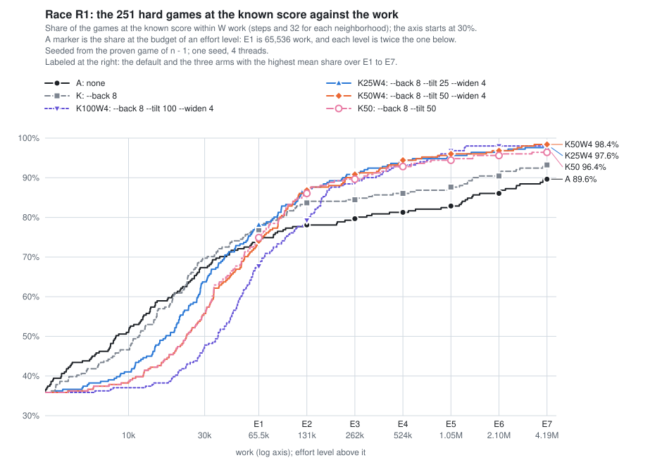

# A share of tilted neighborhoods (2026-11)

Part of the [lab notebook](../../README.md).

Started 2026-11-07.  Concluded 2026-11-07.

**Question.**  Does tilting a share of each trajectory's neighborhoods (`--tilt P`) keep the uniform draw's quick finds at
low levels of effort and the tilt's reach at high ones?  The race is `--back 8 --widen 4` with P of 25, 50 and 100 and two
controls (`--back 8` alone, and `--back 8 --tilt 50` without `--widen`), on the 251 hard games of 3441-5060 at effort 7.

**Answer.**  From effort 1 up, yes; under 65,536 work, no.  `--back 8 --tilt 25 --widen 4` (K25W4) holds 78.1, 87.3, 91.2,
94.0, 95.2, 96.8 and 97.6% of the 251 at efforts 1 to 7.  It ties `--back 8` alone at effort 1 (196 games against 193),
leads it by 11 to 20 games from effort 3, and ends one game behind the full tilt at effort 7 (245 against 246), but it
trails the uniform draw under 65,536 work (103 games at 10^4 work against 117).  A share of 50 percent holds 74.1 to 98.4%
and no level separates it from 25 percent (from effort 2 on at most 2 games apart, p at least 0.5), so the data support
25 percent as a default and cannot prefer it to 50 by more than a seed's noise.  It is one seed.

## Method

*The mode and the option.*  A game of the unsound mode
([unsound.rs](https://github.com/bvchess/taxman/blob/8dc6500/solver/frame/src/solver/unsound.rs)) starts as a proven search
does, seeded with the moves for n − 1, then plays rounds of 64 large neighborhoods worked from one or more trajectories of
incumbents ([REFERENCE, "An unsound
line"](https://github.com/bvchess/taxman/blob/8dc6500/solver/docs/REFERENCE.md#an-unsound-line)).  Effort E is a budget of
*work*, 2^(E−1) × 65,536, which the rounds run until they reach; a round's work is its steps and 32 for each neighborhood.
`--tilt P` tilts P percent of each trajectory's neighborhoods, which free the small promotions more often, and draws the
rest uniformly ([finder.rs, `draws_tilted`](https://github.com/bvchess/taxman/blob/8dc6500/solver/frame/src/search/finder.rs)).
P of 0 and 100 are the arms of the [race before](../tilted-back-and-wider-rounds-2026-11/README.md) (E3b), as the commit
that added P checked on games 3552, 3800 and 4725.  `--back 8` adds trajectories from the survivors of the moves for
n − 1, ..., n − 8, `--widen 4` moves a trajectory that has stalled for 4 rounds to larger neighborhoods, `--from-known`
takes the proven moves for n − 1 (and n − 2, ..., n − 8 under `--back 8`), and `--stop-at-known` ends a game at the known
score, the built-in table's.

*The games.*  The 251 hard games of 3441-5060, those whose start fell short in the run of 2026-11-01: the 63 of [pilot
P1](../the-unsound-mode-on-the-hard-games-2026-11/README.md) and 188 others (E3b's lists, joined in
[games-all.txt](games-all.txt)).  88 hold the known score at the start, and 2 more hold it in round 0 of a trajectory
under `--back 8`.

*The arms.*  Every game is one command, `taxman solve N --unsound --effort 7 OPTIONS --from-known --stop-at-known --seed 1
--threads 4 --out FILE`, one game at a time at nice 19 ([run_arm_r1.py](run_arm_r1.py)); effort 7 is 4,194,304 work.

| arm | options | lines |
|---|---|---|
| A, the default | none | E3b's, 251 |
| K | `--back 8` | E3b's 63, and 188 of this race |
| K100W4 | `--back 8 --tilt 100 --widen 4` | E3b's arm TKW, 251 |
| K25W4 | `--back 8 --tilt 25 --widen 4` | 251 |
| K50W4 | `--back 8 --tilt 50 --widen 4` | 251 |
| K50 | `--back 8 --tilt 50` | 251 |

*The build and the runs.*  K25W4, K50W4 and K50 ran on master [8dc6500](https://github.com/bvchess/taxman/commit/8dc6500),
release without fat LTO, and K's 188 games on [cd3c3ac](https://github.com/bvchess/taxman/commit/cd3c3ac), whose lines
with `--tilt 0` are 8dc6500's.  On 2026-11-07 K ran from 00:26 to 00:52 PST in six processes (at most 24 threads) and the
other three arms from 00:59 to 01:21 in 18 (at most 72 threads), beside other work on a machine of 88 threads, so the
seconds run long and the work is exact.  The runs took 24 thread-hours.

*The analysis* ([analyze.py](analyze.py), whose output is [out.txt](out.txt)) checks the lines and computes every number
below, using E3b's functions for a line's record, its consistency, the sign test and the time model.  A game's *work to the
known score* is the work through the round that reached it (0 if the start, or a trajectory's start, held it), and it is
at the known score at effort E if that work is at most E's budget.  The run of effort E also plays the round that crosses
its budget, so the share is a lower bound by up to one round's work, a median 43,000 for the full tilt.  Section 2 also
gives an estimate, which spreads the work since a line's last earlier improvement over the rounds in between.

## Results

**1. The lines pass the checks.**  All 1,506 lines (251 an arm) have method `search`, effort 7, budget 4,194,304, `fix`
0.7,0.9, seed 1, 4 threads, `from_known`, their arm's `tilt` (a percent; E3b's build wrote `true` for 100 and `false` for
0), `back` and `widen`, and the build of their file with a clean tree (8dc6500 for the 753 lines of K25W4, K50W4 and K50,
cd3c3ac for the other 753).  Each line is consistent in itself (work is steps and 32 a neighborhood, scores rise to the
final one, a game short of the known score used its budget), scores at most the table's score in
`results/optimal.jsonl.gz` (read with gzip), which is also its known score, and has the start, `in_the_bag`, setup and
moves for n − 1 of every other arm.  This race's files agree with their logs, and an independent count of the shares, made
before this analysis, agrees with every cell of the next table.

**2. The share at each level of effort.**  Games of the 251 at the known score within the budget of each level, as a
percent (lower bound):

| arm | E0 | E1 | E2 | E3 | E4 | E5 | E6 | E7 | E7 games |
|---|---|---|---|---|---|---|---|---|---|
| A | 35.1 | 74.1 | 78.1 | 79.7 | 81.3 | 82.9 | 86.1 | 89.6 | 225 |
| K | 35.9 | 76.9 | 83.7 | 84.5 | 86.1 | 87.6 | 90.4 | 93.2 | 234 |
| K100W4 | 35.9 | 67.7 | 79.3 | 88.8 | 92.8 | 96.8 | 98.0 | 98.0 | 246 |
| K25W4 | 35.9 | 78.1 | 87.3 | 91.2 | 94.0 | 95.2 | 96.8 | 97.6 | 245 |
| K50W4 | 35.9 | 74.1 | 86.9 | 90.8 | 94.4 | 96.0 | 96.8 | 98.4 | 247 |
| K50 | 35.9 | 74.9 | 86.1 | 89.6 | 92.8 | 94.4 | 95.6 | 96.4 | 242 |

* **The lower bound understates the large rounds at effort 1 and 2.**  A round takes a median 3,800 work for A, 4,200 for
  K, 17,900 for K25W4, 25,700 for K50W4 and 42,700 for K100W4 (section 5), against 65,536 at effort 1.  With the estimate
  the percent at effort 1 is 74.5, 78.5, 73.7, 79.7, 78.1 and 79.3 (A, K, K100W4, K25W4, K50W4, K50) and at effort 2 78.1,
  83.7, 84.5, 87.3, 87.6 and 87.6.  From effort 3 the two agree within 0.4 points, but for the full tilt at effort 3 (88.8
  and 90.0).
* **Of the 568 searched games of 3441-5060**, by the rule of P1 (the 317 whose start held the best score stay at it),
  K25W4 holds 90.3, 94.4, 96.1, 97.4, 97.9, 98.6 and 98.9% at efforts 1 to 7, K50W4 88.6, 94.2, 96.0, 97.5, 98.2, 98.6 and
  99.3%, and the default 88.6, 90.3, 91.0, 91.7, 92.4, 93.8 and 95.4%.

**3. The share within a budget of work.**  Games of the 251:

| arm | 10^4 | 3×10^4 | 10^5 | 3×10^5 | 10^6 | 4×10^6 | games missed | work summed |
|---|---|---|---|---|---|---|---|---|
| A | 128 | 169 | 194 | 201 | 207 | 225 | 26 | 154.2 million |
| K | 117 | 175 | 205 | 213 | 218 | 233 | 17 | 109.3 million |
| K100W4 | 93 | 120 | 189 | 226 | 241 | 246 | 5 | 46.2 million |
| K25W4 | 103 | 160 | 209 | 230 | 239 | 245 | 6 | 48.3 million |
| K50W4 | 97 | 140 | 208 | 229 | 240 | 247 | 4 | 47.1 million |
| K50 | 97 | 140 | 209 | 227 | 237 | 242 | 9 | 59.9 million |

The work summed is the work to the known score over the 251 games, a game not reached counting as its budget of 4,194,304.

* **A share of tilted neighborhoods does not keep the quick finds under 10^5 work**, but loses fewer of them: K25W4 holds 14
  and 15 fewer games than K at 10^4 and 3×10^4 work, K50W4 and K50 20 and 35, K100W4 24 and 55.  A game that a uniform
  round finds early arrives later in work when a round costs four times as much.
* **At 10^5 work K25W4 is level with the best** (209; K 205, default 194), and from 3×10^5 the arms with a tilt hold 226 to
  230 against K's 213.

**4. The share by stretch of n**, as a percent of the games, at E1, E3, E5 and E7:

| stretch (games) | arm | E1 | E3 | E5 | E7 |
|---|---|---|---|---|---|
| 3441-4000 (111) | K | 71.2 | 79.3 | 82.9 | 91.0 |
| | K100W4 | 65.8 | 85.6 | 95.5 | 98.2 |
| | K25W4 | 71.2 | 89.2 | 92.8 | 97.3 |
| | K50W4 | 70.3 | 86.5 | 94.6 | 99.1 |
| 4001-4560 (75) | K | 77.3 | 85.3 | 89.3 | 92.0 |
| | K100W4 | 69.3 | 90.7 | 97.3 | 97.3 |
| | K25W4 | 78.7 | 92.0 | 97.3 | 97.3 |
| | K50W4 | 73.3 | 94.7 | 97.3 | 97.3 |
| 4561-5060 (65) | K | 86.2 | 92.3 | 93.8 | 98.5 |
| | K100W4 | 69.2 | 92.3 | 98.5 | 98.5 |
| | K25W4 | 89.2 | 93.8 | 96.9 | 98.5 |
| | K50W4 | 81.5 | 93.8 | 96.9 | 98.5 |

* **The pattern holds in every stretch**: K25W4 leads or ties at E1, the arms with a tilt are within 3 points of each other
  from E5, and they gain most over K in the first stretch (E7: 97 to 99% against 91%).  In the last stretch every arm but
  the default misses one game, 4950.

**5. The cost.**  Over the lines whose rounds took 3 s or more (seconds of the rounds on 4 threads; E3b's lines that began
after its prover ended are left out):

| arm | lines | seconds per 10^6 work | steps per neighborhood | steps per neighborhood against K's | rounds of a game that used effort 7 |
|---|---|---|---|---|---|
| A | 67 | 76.4 | 28 | 0.77 | 1,135 (26 games) |
| K | 69 | 61.0 | 33 | 1 | 1,118 (17) |
| K100W4 | 135 | 98.4 | 635 | 10.6 | 36 (5) |
| K25W4 | 79 | 76.1 | 248 | 3.6 | 57 (6) |
| K50W4 | 88 | 73.0 | 369 | 5.9 | 46 (4) |
| K50 | 85 | 68.9 | 248 | 4.8 | 360 (9) |

* **Steps per neighborhood are exact, and agree with E3b's** (default 28; full tilt 635 against 700 on its 31 lines).  The
  steps grow with the share: K50 takes 4.8 times K's, where a fully tilted neighborhood takes about nine times.  `--widen`
  adds more: K50W4 takes 5.9 times K's, and a game that uses the whole budget runs 46 rounds against K50's 360.
* **Work tracks time across the three arms that ran together**: over 72 games K50W4 costs 0.98 times K25W4's seconds per
  work (0.83-1.24) and K50 0.94 times K50W4's.  Seconds do not compare across runs (K ran on a quieter machine, K100W4 and A
  beside E3b's prover).  The 251 games take K25W4 5,034 s of 4 threads, K50W4 4,977 s and K50 5,267 s.

**6. Game by game.**  Games the first arm holds within the budget of the level that the second does not, and the reverse
(lower bound), with the two-sided sign test:

| first against second | E1 | E3 | E5 | E7 |
|---|---|---|---|---|
| K25W4, K | +14 / −11 (0.69) | +19 / −2 (<0.001) | +20 / −1 (<0.001) | +12 / −1 (0.003) |
| K25W4, K100W4 | +30 / −4 (<0.001) | +9 / −3 (0.15) | +2 / −6 (0.29) | +1 / −2 (1.0) |
| K50W4, K | +11 / −18 (0.27) | +19 / −3 (0.001) | +23 / −2 (<0.001) | +13 / −0 (<0.001) |
| K50W4, K100W4 | +23 / −7 (0.005) | +8 / −3 (0.23) | +3 / −5 (0.73) | +1 / −0 (1.0) |
| K25W4, K50W4 | +15 / −5 (0.04) | +4 / −3 (1.0) | +1 / −3 (0.63) | +0 / −2 (0.5) |
| K50W4, K50 | +1 / −3 (0.63) | +7 / −4 (0.55) | +7 / −3 (0.34) | +5 / −0 (0.06) |

* **K25W4 against K** at effort 7 gains 3480, 3549, 3572, 3723, 3750, 3840, 3848, 3900, 4032, 4056, 4205 and 4275, and loses
  3844.  **Against K100W4** it gains 3723 and loses 3610 and 3844.
* **K25W4 against K50W4**: the 15 to 5 at effort 1 is the only split under p = 0.05 among the 7 levels, and with the
  estimate it is 12 to 8 (p = 0.50).  At effort 7 K25W4 loses 3610 and 3844, which K50W4 reaches at 419,000 and 2.9 million
  work.  The tests are not corrected for the many comparisons.
* **K50W4 against K50** (what `--widen` adds): at effort 7 it gains 3572, 3610, 3723, 3740 and 4056 and loses none; at
  efforts 4 to 6 it gains 9, 7 and 5 games and loses 5, 3 and 2.  None of these is significant.
* **Against the default** K, K25W4 and K50W4 gain 10, 21 and 23 games at effort 7 and lose 4950.

**7. What no arm reaches.**  Three games, 3968, 4134 and 4225, stay 3, 1 and 4 points short in every arm: no trajectory ever
improved on the start in them, in 36 to 1,142 rounds.  4950 is reached only by the default, in round 137 (1.2 million
work); the arms with a tilt improve it and stop 79 short after 38 to 154 rounds, and K stops 143 short after 629.  The
rest differ by arm: K25W4 misses 3610 and 3844 (28 and 12 short), K100W4 3723, K50 nine games, K 17 and the
default 26.  The six arms together reach 248 of the 251.

## What this means for the unsound mode

* **The data support K25W4 as the default, and cannot prefer it to K50W4 by more than noise.**  It has the smallest total
  shortfall from the best arm at each level (4.0 points over E1 to E7, against 6.8 for K50W4 and 22.7 for K100W4), the
  highest share at efforts 1 to 3 on the lower bound (and the highest mean over E1 to E7, 91.5% against 91.1%, or 91.9%
  against 91.8% with the estimate), and a round about 30% cheaper than K50W4's.  From effort 2 on the two differ by at most
  2 games, and the games they split (at most 7 on a side) split evenly (p at least 0.5); the 4 points between them at
  effort 1 shrink to 1.6 with the estimate.  The race cannot say whether a default should tilt 25 or 50 percent; 25 is
  never more than 1.6 points below the best arm.
* **Tilt a small share, not all.**  Against K25W4 the full tilt gives up 10 points at effort 1 and 8 at effort 2 (6 and 3
  with the estimate, where the split at effort 1 is 21 to 6, p = 0.006), and gains at most 1.6 points, 4 games, at effort 5 (p = 0.29).
* **`--widen` adds about 1 point on the mean and 5 games at the top**: K50 holds 242 at effort 7, K50W4 247 (p = 0.06), and
  they are within 3 games at efforts 1 to 3, since widening acts only after a stall of 4 rounds.  It costs rounds, not
  share: a game that uses effort 7 runs 46 rounds with `--widen` and 360 without.
* **What each level gives** (K25W4 beside the default; seconds are the median and 90th percentile of a full run by E3b's
  model, on a loaded machine; shares are lower bounds):

| effort | work | K25W4 share | K25W4 seconds | default share | default seconds |
|---|---|---|---|---|---|
| 1 | 65,536 | 78.1% | 8 / 12 | 74.1% | 9 / 17 |
| 2 | 131,072 | 87.3% | 13 / 19 | 78.1% | 14 / 25 |
| 3 | 262,144 | 91.2% | 23 / 32 | 79.7% | 23 / 42 |
| 4 | 524,288 | 94.0% | 43 / 58 | 81.3% | 42 / 76 |
| 5 | 1,048,576 | 95.2% | 83 / 110 | 82.9% | 79 / 143 |
| 6 | 2,097,152 | 96.8% | 163 / 214 | 86.1% | 155 / 278 |
| 7 | 4,194,304 | 97.6% | 323 / 423 | 89.6% | 307 / 547 |

  Effort 3 gives K25W4's 91.2% in a median 23 s, where the default needs effort 7 and 307 s for 89.6%.
* **What is left.**  At effort 7 K25W4 misses 6 of the 251, an estimated 1.1% of the 568 searched games: 3968, 4134 and
  4225, where no setting moves the start, 4950, which only the default's small neighborhoods reach, and 3610 and 3844,
  which other arms reach.

## What the data cannot tell

* **One seed.**  The sign test over 251 games says how often two arms split a game by chance, which bounds the seed's effect
  on a difference between arms.  It cannot say what another seed would do in 3610, 3844 or 4950.
* **The levels are read from lines that stop at the known score**, not from runs at each level, so a share is a lower bound
  (by up to a round's work) and the estimate a model of the round that crosses the budget.  A real run spends its whole
  budget, and the seconds of a full run are E3b's model.
* **The start is the proven game of n − 1** (and the table's moves for n − 2, ..., n − 8).  A chain of unsound games
  starts from its own lines.
* **The seconds are on a loaded machine**, loaded differently in each run.
* **No arm has `--widen` with no tilt**, so the data cannot say how much of K25W4's gain over K is the tilt and how much is
  `--widen`; E3b's `--widen 4` alone held 62 of its 63 games at effort 7 against the default's 56.
* **The 251 are the hard games of the run of 2026-11-01**; the others are taken as holding the best score at the start.

## Open

* `--back 8 --widen 4`, and P of 10 to 15, on the 251: whether the tilt adds to widening, and where a share stops costing
  quick finds.
* A second seed on the 251, which would decide the games that arms split (3610, 3844, 3572, 3740, 4056).
* Runs at each effort level, not read from lines, for the round that crosses the budget and for the seconds on an idle
  machine.
* 4950, which the default reaches and every arm with `--back 8` does not.

## Files

* [run_arm_r1.py](run_arm_r1.py): plays the games of a file for one arm, one command each, appending to one file, so a rerun
  resumes: `nice -n 19 python3 -I run_arm_r1.py --arm K25W4 --bin TAXMAN --games GAMES --out k25w4-0.jsonl --log
  k25w4-0.log`, for the arms K, K25W4, K50W4 and K50 (A and K100W4 are E3b's lines).
* [games-all.txt](games-all.txt): the 251 games, E3b's `games.txt` and `games-part2.txt` joined (`sort -n`).  K25W4, K50W4
  and K50 played six chunks of it, chunk I being `awk -v i=I '(NR-1)%6==i' games-all.txt`, and K played the 188 games of
  E3b's `games-part2.txt` in six chunks the same way.
* `k0.jsonl` to `k5.jsonl`, `k25w4-0.jsonl` to `k25w4-5.jsonl`, `k50w4-0.jsonl` to `k50w4-5.jsonl` and `k50-0.jsonl` to
  `k50-5.jsonl`: the unsound lines, with the moves, of K on the 188 games and of the other three arms.  The `.log` file
  beside each is the commands and the summary line of each game.  E3b's lines of A, K (63 games) and TKW stay in E3b's
  entry, which the script reads.
* [analyze.py](analyze.py): the checks, every number above and the chart.  `nice -n 19 python3 -I analyze.py
  RESULTS > out.txt`, RESULTS being the main repository's `results/optimal.jsonl.gz`; [out.txt](out.txt) is its output,
  and [share.svg](share.svg) the chart.

No code of the main repository changed.  The code run is that of commits
[8dc6500](https://github.com/bvchess/taxman/commit/8dc6500) and [cd3c3ac](https://github.com/bvchess/taxman/commit/cd3c3ac).
