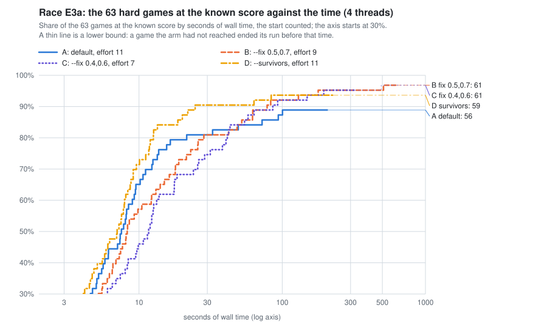

# Larger neighborhoods and a second base (2026-11)

Part of the [lab notebook](../../README.md).

Started 2026-11-06.  Concluded 2026-11-06.

**Question.**  On the 63 hard games of [pilot P1](../the-unsound-mode-on-the-hard-games-2026-11/README.md) (3441-5060,
each short at the start in the run of 2026-11-01), which setting of the unsound mode brings the most games to their
known score at equal time, and how does each one's share grow with time?  The settings: the default; larger
neighborhoods (`--fix 0.5,0.7` and `--fix 0.4,0.6`); and a second trajectory of incumbents that begins from what
survives of the game before (`--survivors`).

**Answer.**  Every setting beats the default from 100 s on, and each misses games the others reach.  Within 100 s of
wall time on 4 threads the default holds 55 of the 63 games, `--fix 0.5,0.7` and `--fix 0.4,0.6` 58 each, and
`--survivors` 59; within 300 s, 56 (a lower bound), 60, 60 and 59.  `--survivors` costs the same per round as the
default and leads early (45 and 57 games at 10 s and 30 s, against 41 and 51); it reaches 3 of the 7 games the default
missed in 1,024 rounds (3600, 3850, 4104).  Larger neighborhoods cost 9.6 and 22 times as much per round, trail the
default at 10 s (36 and 29 games), lead after 100 s, and reach 5 of the 7 each (both reach 3552, 3600, 3723 and 4232; `--fix 0.5,0.7` also 4056 and `--fix 0.4,0.6` also 4104).
No setting loses a game the default reaches, the settings miss different games (the four together reach all 63), and
playing `--survivors` for 30 s and then `--fix 0.5,0.7` again from the start reaches 62 games by 300 s.  It is one seed
and 63 games.

## Method

*The mode and its options.*  A game of the unsound mode
([unsound.rs](https://github.com/bvchess/taxman/blob/fa05cac/solver/frame/src/solver/unsound.rs)) makes the start of a
proven search, seeded with the moves for n − 1, and then plays rounds of large neighborhood search of 64 neighborhoods
([finder.rs, "On many threads, alone"](https://github.com/bvchess/taxman/blob/fa05cac/solver/frame/src/search/finder.rs)).
Each neighborhood keeps a random share of the incumbent's promotions fixed and searches the rest exactly for at most
1,024 steps; effort E is 2^(E−1) rounds.  Two options shape the rounds
([REFERENCE, "An unsound line"](https://github.com/bvchess/taxman/blob/fa05cac/solver/docs/REFERENCE.md#an-unsound-line)):
`--fix LO,HI` draws the share fixed from LO to HI (default 0.7,0.9; a lower share is a larger neighborhood), and
`--survivors` adds a second trajectory from the promotions of the moves for n − 1 that can still be promoted, each of
the two with 32 of a round's 64 neighborhoods.  `--from-known` seeds each game with the proven moves for n − 1, and
`--stop-at-known` ends a game at the known score, the built-in table's.

*The build.*  Master fa05cac, release without fat LTO (`profile.release.lto=false`, `codegen-units=16`), built at -j 4
in 2 min 49 s.  Every line of the four arms records `"build": {"commit": "fa05cac...", "dirty": false}`.

*The games.*  The 63 games of P1's [games.txt](games.txt), in order.  23 hold the known score at the start; the other 40
are the ones the rounds work on.

*The arms.*  Every game is one command, `taxman solve N --unsound --effort E [OPTIONS] --from-known --stop-at-known
--seed 1 --threads 4 --out FILE`, at nice 19, one game at a time ([run_arm.py](run_arm.py)).

| arm | options | effort (rounds) | games run |
|---|---|---|---|
| A, the default | none | 11 (1,024) | the 7 games P1's seed 1 missed; the other 56 are P1's seed-1 lines |
| B | `--fix 0.5,0.7` | 9 (256) | 63 |
| C | `--fix 0.4,0.6` | 7 (64) | 63 |
| D | `--survivors` | 11 (1,024) | 63 |

P1's seed-1 lines are arm A up to round 256, because a line depends on the game, its start, the seed and the options
only, and a run of more rounds does those of fewer first.  P1 ran effort 9 on build e37d6a1, so the lines were checked
against this build: 3465 (4 rounds) and 4180 (238 rounds) played again at effort 9 give the same lines.

*The runs.*  On 2026-11-06, on the machine of 88 threads that runs the prover on every thread at idle priority, never
more than two runs of 4 threads at once.  The check of A ran 15:06-15:08.  B and C started together at 15:08; C ended at
15:52 and B at 15:58.  A started when C ended (15:52-16:23) and D when B ended (15:58-16:27), so two runs overlapped at
a time: B with C until 15:52, B with A until 15:58, A with D until 16:23, and D alone to 16:27.  No run was stopped.  The runs of 4 threads took
10.3 thread-hours in all.

*The analysis* ([analyze.py](analyze.py), whose output is [out.txt](out.txt)) checks the lines and computes the numbers
below.  A game's time is its wall time on 4 threads up to the improvement that reached the known score, the start
included (the start's time for a game that holds it at the start).  Its steps are the line's steps, since the line
ends there; the start's steps are the same in every arm and are not counted.

## Results

**1. The lines pass the checks.**

* All 196 lines of B, C, D and A's 7 have method `search`, the arm's effort, `--fix` and `--survivors`, seed 1, 4
  threads, `from_known`, the table as the source of the moves for n − 1, `trajectories` 1 (2 for D), and no score above the
  table's.  Arms A, B and C have trajectory 0 in every improvement.
* The start, `in_the_bag`, the known score, the setup and the moves for n − 1 are the same in every arm, P1's lines
  included, in all 63 games.
* The two replayed lines (3465 and 4180) equal P1's in every key but the times, the build and the keys the new build
  adds (`fix`, `survivors`, `trajectories`, `trajectory`).

**2. The race at equal time.**  Games of the 63 at the known score within T seconds (a `+` marks a lower bound: a game
the arm had not reached ended its run before T):

| arm | 10 s | 30 s | 100 s | 300 s | 500 s |
|---|---|---|---|---|---|
| A, default | 41 (65.1%) | 51 (81.0%) | 55 (87.3%) | 56+ (88.9%) | 56+ (88.9%) |
| B, `--fix 0.5,0.7` | 36 (57.1%) | 51 (81.0%) | 58 (92.1%) | 60 (95.2%) | 60 (95.2%) |
| C, `--fix 0.4,0.6` | 29 (46.0%) | 47 (74.6%) | 58 (92.1%) | 60 (95.2%) | 61+ (96.8%) |
| D, `--survivors` | 45 (71.4%) | 57 (90.5%) | 59 (93.7%) | 59+ (93.7%) | 59+ (93.7%) |

* **`--survivors` is first, the larger neighborhoods are last, and then they overtake the default.**  At 10 s and 30 s D
  holds 4 and 6 games more than A; B equals A at 30 s and C trails by 4.  Between 30 s and 100 s B gains 7 games and C 11,
  and from 100 s on both hold 3 to 4 more than A.  D flattens at 59 after 100 s; A at 55-56.
* **Of the 40 games short at the start**, the shares within 10, 30, 100, 300 and 500 s are A 18, 28, 32, 33+, 33+; B 13,
  28, 35, 37, 37; C 6, 24, 35, 37, 38+; D 22, 34, 36, 36+, 36+.
* **The ends differ by the budgets.**  A reaches 56 (within 1,024 rounds), B 61 (256 rounds), C 61 (64 rounds) and D
  59 (1,024 rounds).  The one game that separates B from C at 500 s is 3552, which B reaches at 510 s and C at 492 s.
* **The runs the arms ended without the known score took** A 206-331 s (7 games), B 631 and 642 s (2), C 323 and 390 s
  (2), D 224-342 s (4); this is why a cell is a lower bound after the first of those times.

**2b. The race at equal steps** (the steps of the rounds, which do not depend on the machine; a `+` as above):

| arm | 10,000 | 30,000 | 100,000 | 300,000 | 1,000,000 | 3,000,000 |
|---|---|---|---|---|---|---|
| A | 40 | 48 | 52 | 53 | 56 | 56+ |
| B | 23 | 35 | 46 | 53 | 58 | 60 |
| C | 23 | 24 | 43 | 53 | 58 | 60 |
| D | 41 | 53 | 57 | 57 | 59 | 59+ |

* **Steps tell the same story as seconds.**  D is ahead of A at every budget (it costs the same per step), and B and C
  meet A at 300,000 steps and pass it at 1 million.  The 23 of B and C at 10,000 steps are the games that hold the known
  score at the start; a round of B or C is about 30,000 and 70,000 steps.
* **A step costs less in a larger neighborhood**: 0.49 and 0.47 thread-milliseconds in B and C against 0.80 in A, since
  the fixed part of a neighborhood spreads over more steps (section 5).

**2c. The estimate for the 568 searched games of 3441-5060**, by P1's rule: (317 + 251 × the sample's share) / 568, with
the exact 90% interval of the share carried through.  With each arm's own budget: A 95.1% (91.2-97.6), B and C 98.6%
(95.7-99.7), D 97.2% (93.8-99.0).  The intervals overlap, and the rule carries P1's limits.  By time: within 100 s, A
94.4%, B and C 96.5%, D 97.2%; within 30 s, 91.6%, 91.6%, 88.8% and 95.8%.

**3. Which arm reaches which of the 7 games the default missed** (round, seconds, steps; or the final shortfall in
points, and the round of the last improvement):

| n | start short | A, default (1,024 rounds) | B, `--fix 0.5,0.7` | C, `--fix 0.4,0.6` | D, `--survivors` |
|---|---|---|---|---|---|
| 3552 | 97 | no, 97 short, no improvement | r135, 510 s, 4.0 M steps | r51, 492 s, 3.7 M | no, 97, no improvement |
| 3600 | 262 | no, 74 short, last r187 | r4, 13 s, 83 k | r3, 24 s, 211 k | r5, 3 s, 9 k |
| 3723 | 3 | no, 3 short, no improvement | r37, 130 s, 1.5 M | r26, 195 s, 2.3 M | no, 3, no improvement |
| 3850 | 18 | no, 18 short, no improvement | no, 18, no improvement (256 rounds) | no, 18, no improvement (64 rounds) | r31, 13 s, 57 k |
| 4056 | 64 | no, 54 short, last r39 | r23, 52 s, 426 k | no, 54, last r2 | no, 54, last r46 |
| 4104 | 36 | no, 1 short, last r3 | no, 1 short, last r1 | r7, 55 s, 395 k | r1, 6 s, 3 k |
| 4232 | 94 | no, 94 short, no improvement | r47, 178 s, 1.2 M | r4, 41 s, 265 k | no, 94, no improvement |

* **A reaches 0 of the 7 in 1,024 rounds**, four times the rounds of P1, and ends at P1's scores.  B reaches 5, C 5, D 3.
* **No arm loses a game the default reaches** (B, C and D each reach all 56 of A's); no game is missed by all four.  Each
  arm misses games the others reach: B 3850 and 4104, C 3850 and 4056, D 3552, 3723, 4056 and 4232.  3850 is reached only
  by D (A, B and C never improve it in 1,024, 256 and 64 rounds), 4056 only by B.  B and C each gain 5 games on A and
  lose none, a two-sided sign test of p = 0.06; D gains 3 and loses none.
* **The default never improves four of the games** (3552, 3723, 3850, 4232): larger neighborhoods reach the first, second
  and fourth, and the second base reaches 3850.  The three it improves and then sticks at (3600, 4056, 4104) are reached by
  B, C or D; 4056's 54 points are the end of A, C and D alike, and 4104's single point the end of A and B.
* **The default's slow games** (reached after round 16): B is faster in seconds on 5 of the 6 and C on 4.

  | n | A | B | C | D |
  |---|---|---|---|---|
  | 3648 | r24, 10 s | r2, 7 s | r2, 11 s | r24, 9 s |
  | 4180 | r238, 94 s | r7, 62 s | r5, 86 s | r25, 20 s |
  | 4290 | r22, 16 s | r19, 62 s | r19, 149 s | r4, 9 s |
  | 4329 | r238, 100 s | r4, 21 s | r4, 43 s | r238, 84 s |
  | 4416 | r106, 72 s | r6, 42 s | r5, 64 s | r106, 64 s |
  | 4872 | r85, 49 s | r2, 23 s | r2, 38 s | r4, 12 s |

* **On the 33 games both A and B reach that are short at the start**, B's seconds are a median 1.33 times A's (faster in 5)
  and its steps 5.7 times; C's 1.95 (faster in 4) and 9.9 times; D's 0.94 (faster in 27) and 1.0 times.  Rounds needed:
  median 1 (B), 1 (C) and 2 (D) against 4 (A).

**4. The second trajectory made most of D's improvements.**  Of D's 69 improvements, 42 were made by the survivors'
trajectory (1) and 27 by the start's (0).  Of the 36 games short at the start that D reached, the improvement that reached the
known score came from trajectory 1 in 24 and from trajectory 0 in 12; 21 games (including the missed 4056) were improved
by trajectory 1 alone, 7 by both, and 9 by trajectory 0 alone.  The first improvement of a game is trajectory 1's in 26 of the 37 games
that improved (21 of them in round 1); D's single improvement of 3850 (round 31) is trajectory 1's.  D is not faster than A on 6 of the 33 games
both reach, the largest 4752 (round 34, 18.7 s, against round 7, 11.1 s).

**5. The cost** (4 threads at nice 19, on a machine whose other threads run the prover at idle priority).  A round's
seconds are the rounds' time up to the last round, over the lines whose rounds took at least 3 s, so that the fixed cost of a
line (about 0.1 s) weighs little; a neighborhood's steps are the line's steps over its neighborhoods:

| n | arm | lines | seconds per round: median (min-max) | steps per neighborhood: median (min-max) |
|---|---|---|---|---|
| 3441-3800 | A | 4 | 0.28 (0.20-0.31) | 20 (13-36) |
| | B | 5 | 3.4 (2.4-3.9) | 546 (324-703) |
| | C | 9 | 6.0 (3.7-9.6) | 1,058 (459-1,368) |
| | D | 3 | 0.22 (0.22-0.33) | 22 (14-36) |
| 3801-4200 | A | 6 | 0.30 (0.21-0.47) | 25 (22-28) |
| | B | 9 | 2.9 (2.0-7.6) | 394 (288-678) |
| | C | 10 | 6.8 (5.0-15.5) | 993 (796-1,403) |
| | D | 4 | 0.30 (0.21-0.46) | 32 (22-45) |
| 4201-4600 | A | 4 | 0.42 (0.32-0.62) | 34 (28-61) |
| | B | 8 | 3.6 (3.0-6.0) | 453 (363-811) |
| | C | 9 | 7.2 (5.0-11.5) | 1,010 (719-1,542) |
| | D | 3 | 0.33 (0.32-0.54) | 35 (28-61) |
| 4601-5060 | A | 6 | 0.56 (0.36-1.31) | 42 (22-117) |
| | B | 11 | 7.0 (2.2-9.7) | 737 (288-1,000) |
| | C | 12 | 13.1 (5.1-18.7) | 1,446 (663-1,853) |
| | D | 5 | 0.77 (0.31-3.92) | 53 (30-463) |
| all | A | 20 | 0.36 (0.20-1.31) | 28 (13-117) |
| | B | 33 | 3.8 (2.0-9.7) | 502 (288-1,000) |
| | C | 40 | 7.5 (3.7-18.7) | 1,099 (459-1,853) |
| | D | 15 | 0.33 (0.21-3.92) | 35 (14-463) |

* **Game by game, a round of B costs a median 9.6 times the default's seconds** (6.1 to 21; 19 games) and 14.8 times its
  steps; **C 22 times** (14 to 43; 20 games) and 37.6 times; **D 1.00** (0.64 to 3.0; 15 games) and 1.11 times.
* **C's neighborhoods mostly stop at the limit.**  Their median of 1,099 steps is above the 1,024 of one block (the
  engine counts in blocks of 1,024), so most are not searched to the end; B's median of 502 is a mix that the lines do
  not split.  Cost grows with n in every arm; the default's round at 4601-5060 costs twice its round at 3441-3800.
* **D's expensive rounds are its first**: where the survivors' incumbent starts far below the start's (4851: 3.9 s for one
  round, 463 steps a neighborhood), the second trajectory's neighborhoods are larger.
* **The seconds of all 63 lines**: A 2,582 (56 of them P1's), B 2,988, C 2,594, D 1,695.  Of those, 1,873, 1,273, 713 and
  1,124 were spent on the games each arm missed.  The start takes a median 5.1 s, the same in every arm.

**6. One arm for H seconds and then another, played again from the start.**  The second run is B or C's own line less its
start (the first run made it), and the first run's incumbent is not carried over: two runs, not one schedule.  Games at
the known score within T seconds:

| plan | 10 s | 30 s | 100 s | 300 s | 500 s | seconds of 4 threads for the 63 games, games reached |
|---|---|---|---|---|---|---|
| A alone | 41 | 51 | 55 | 56+ | 56+ | 2,576; 56 |
| B alone | 36 | 51 | 58 | 60 | 60 | 2,982; 61 |
| C alone | 29 | 47 | 58 | 60 | 61+ | 2,588; 61 |
| D alone | 45 | 57 | 59 | 59+ | 59+ | 1,689; 59 |
| A 10 s, then B | 41 | 52 | 58 | 60 | 60 | 2,916; 61 |
| A 30 s, then C | 41 | 51 | 57 | 60 | 60+ | 2,478; 61 |
| D 10 s, then B | 45 | 54 | 59 | 61 | 61 | 2,194; 62 |
| D 30 s, then B | 45 | 57 | 60 | 62 | 62 | 1,503; 63 |
| D 30 s, then C | 45 | 57 | 60 | 61 | 61+ | 1,727; 62 |

* **The default for a few seconds and then B follows both of its parts**: it keeps the default's lead at 10 s, B's at
  100 s and after, and passes both at 30 s (52 against 51 and 51).
* **`--survivors` for 30 s and then B has no weak time**: it ties or leads every other plan at every time and reaches 62
  games by 300 s, where the best single arm reaches 60.  Its 63 comes from the two games that only D (3850) and only B
  (4056) reach, which the plan was chosen after seeing, so 62 or 63 is an upper estimate.
* **The plans with H = 100 s** (not in the table) add nothing over H = 30 s.

## What this means for the unsound mode

* **Turn the second trajectory on.**  `--survivors` costs nothing more per round or per step (1.00 and 1.11 times),
  leads at 10 s and 30 s, holds 59 games where the default holds 56, and reaches games the default cannot move (3850), by
  a base that is not the start's.  Of the 36 games it reached, 24 reached the known score by the second trajectory.  The
  data support it as a default for every level of effort; it is the cheapest gain in the race.
* **Larger neighborhoods are for the stall, not the start.**  A round costs 10 to 22 times as much, so they trail the
  default until about 30 s, and they pay after that for the games whose rounds stop improving: the default's slow games
  (rounds 85 to 238) in 21 to 62 s, and the games it cannot move (3552, 3723, 4232) in 41 to 510 s.  Moving from the
  default's neighborhoods to larger ones when the rounds stop improving (the plan "A 10 s, then B") follows both curves
  in the restart form this entry measures.
* **`--fix 0.5,0.7` over `--fix 0.4,0.6`.**  At equal time they are tied at 100 s and 300 s (58 and 60 each), and B costs
  about half as much a round (3.8 s against 7.5 s) and reaches 4056, which C does not; C reaches 4104 and is faster to
  3552 (by 18 s) and 4232.  C's
  neighborhoods hit the step limit, so they search less of what they open; the data do not say whether a higher limit would
  change it.
* **The combination to test next** is `--survivors` with `--fix 0.5,0.7` in one run, and a schedule that moves from
  the default's fix to a larger one inside a run, which carries the incumbent on.  The restart plans of section 6 suggest
  `--survivors` for about 30 s and then `--fix 0.5,0.7` (62 games by 300 s), and the games that remain are 3552 (500 s in
  B and C) and the games the arms miss.
* **Why.**  P1 found the default's stalls to be fixed points of small neighborhoods: 27 steps a neighborhood, 70-90% of the
  promotions fixed.  Neighborhoods of 400 to 1,000 steps open them (3552, 3723, 4232), at a cost per round that is 10 to 22
  times the default's; the second base reaches 3850 and 3600 by a different incumbent at no extra cost; and 4056's 54
  points are a fixed point of the default, of the second base and of 0.4,0.6, and not of 0.5,0.7.

## What the data cannot tell

* **One seed, 63 games.**  P1's second seed changed which games a seed reached (it recovered 1 of 7), so which games each
  arm misses here may change with the seed.  The differences between B, C and D rest on a few games: 3850, 4056, 4104, and
  3552 at 492 and 510 s.  The sign test of B or C against A is p = 0.06.
* **The plans of section 6 were chosen after the data.**  They restart the second arm and do not carry an incumbent; the
  schedule that does, and `--survivors` with `--fix` in one run, were not run.
* **The arms have different budgets.**  A and D ran 1,024 rounds, B 256 and C 64.  C ended its two misses at 323 and 390 s
  and might reach them with more rounds; A, B and D may reach more with more.  A cell is a lower bound after the shortest
  run of a miss.
* **The times are on a loaded machine.**  Two runs of 4 threads at once, the prover at idle priority on the same cores, and
  a run of another study on 2 threads that I saw in the process list at 16:27, started about 16:20, when the last of D's
  games were running (I looked at no other time).  A's
  56 games are P1's lines from 13:03-13:25, the others 15:08-16:27, at the same load and a different hour.  An idle machine
  would be faster per thread.
* **The start is from the proven game of n − 1.**  The mode starts from its own line of n − 1, which may be short, and the
  survivors that D follows are what survives of that line.  D's advantage is measured with the best possible survivors.
* **The games stop at the known score**, so the rounds after it are unmeasured.  Reaching it is an equal score, not the
  same moves.
* **The hard games are the ones the run of 2026-11-01 started short** and P1 sampled every 4th; the 317 games whose start held
  the best score were not run.  The estimates of 2c carry that.

## Open

* `--survivors --fix 0.5,0.7` in one run on these 63 games, and a schedule inside one run.
* More seeds on 3552, 3850, 4056 and 4104, to tell fixed points from unlucky draws, and C with more than 64 rounds.
* A higher step limit for neighborhoods of `--fix 0.4,0.6`.
* The mode on its own line of n − 1 instead of the proven one, which measures the drift for the survivors.
* The same arms on an idle machine.

## Files

* [run_arm.py](run_arm.py): plays the games of a file for one arm, one command each, appending to one file, so a rerun
  resumes.  `nice -n 19 python3 -I run_arm.py --arm B --bin TAXMAN --games games.txt --out arm-b.jsonl --log arm-b.log`,
  for the arms A (with `misses-a.txt`), B, C and D, and A9 (with `check-a9.txt`) for the check of the build.
* [games.txt](games.txt): P1's 63 games.  [misses-a.txt](misses-a.txt): the 7 games P1's seed 1 missed.
  [check-a9.txt](check-a9.txt): the 2 games played again at P1's effort.
* [arm-a.jsonl](arm-a.jsonl), [arm-b.jsonl](arm-b.jsonl), [arm-c.jsonl](arm-c.jsonl), [arm-d.jsonl](arm-d.jsonl): the
  unsound lines of each arm, with the moves (arm A's are the 7 games; the other 56 are P1's
  [seed-1.jsonl](../the-unsound-mode-on-the-hard-games-2026-11/seed-1.jsonl)).
  [arm-a9-check.jsonl](arm-a9-check.jsonl): the two lines of the check.  The `.log` files beside them are the commands and the summary
  line of each game.
* [analyze.py](analyze.py): the checks of the lines, every number above and the chart.  `nice -n 19 python3 -I analyze.py >
  out.txt`; [out.txt](out.txt) is its output, and [race.svg](race.svg) the chart.

No code of the main repository changed.  The code run is that of commit
[fa05cac](https://github.com/bvchess/taxman/commit/fa05cac).
