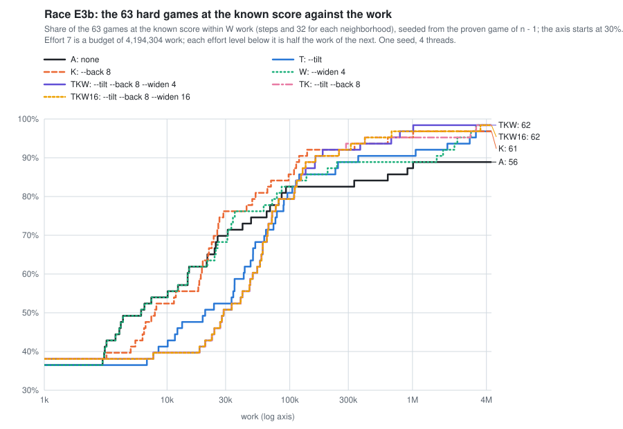

# Tilted, back and wider rounds (2026-11)

Part of the [lab notebook](../../README.md).

Started 2026-11-06.  Concluded 2026-11-07.

**Question.**  At equal work, which combination of the unsound mode's three options for the rounds (`--tilt`,
`--back 8`, `--widen`) brings the most hard games to their known score soonest, and does the winner hold up on hard games
the race did not choose it on?  The race is seven settings on the 63 hard games of [pilot
P1](../the-unsound-mode-on-the-hard-games-2026-11/README.md), at effort 7 on 4 threads; the hold-out is the winner and
the default on the other 188 hard games of 3441-5060.

**Answer.**  The setting with all three options, `--tilt --back 8 --widen 4` (arm TKW below), wins, and `--back 8` is
most of the gain.  Within 10^6 work the default holds 55 of the 63 games, `--back 8` alone 60 and TKW 61; within 4.2
million work (effort 7) 56, 61 and 62.  On the 188 games the race did not see, TKW holds 180 of 188 within 10^6 work
against the default's 152, and 184 against 169 at effort 7 (sign test, 16 games gained and 1 lost: p = 0.0003).  TKW is
not the better setting everywhere: the larger neighborhoods of `--tilt` take 9 to 22 times the steps of a default
neighborhood, so under 10^5 work TKW holds fewer games than the default (on the 188: 88 against 125 at 3×10^4), and at
effort 1 it trails (67.7% of the 251 hard games against 74.1%).  From effort 3 on it leads by 8 to 14 points: at effort
3, in a median 28 s, it holds 88.8% of the 251, about the 89.6% that the default holds at effort 7 in a median 307 s.
At effort 7 TKW holds 246 of the 251 (98.0%, an estimated 99.1% of the 568 searched games of 3441-5060).  It is one seed.

## Method

*The mode and its options.*  A game of the unsound mode
([unsound.rs](https://github.com/bvchess/taxman/blob/cd3c3ac/solver/frame/src/solver/unsound.rs)) makes the start of a
proven search, seeded with the moves for n − 1, and then plays rounds of large neighborhood search of 64 neighborhoods
([finder.rs, "On many threads, alone"](https://github.com/bvchess/taxman/blob/cd3c3ac/solver/frame/src/search/finder.rs)).
A neighborhood frees a share of the incumbent's promotions and searches the rest exactly for at most 1,024 steps.  Effort E
is a budget of *work*, 2^(E−1) × 65,536, and the rounds go on until their work reaches it; the work of a round is its
steps and 32 for each of its neighborhoods, so that work tracks time whatever the options.  Three options shape the rounds
([REFERENCE, "An unsound line"](https://github.com/bvchess/taxman/blob/cd3c3ac/solver/docs/REFERENCE.md#an-unsound-line)):

* `--tilt` frees as many promotions as before, drawn with weights that favor the small ones (the fit of
  [E5](../how-the-optimal-game-changes-with-n-2026-11/README.md)).
* `--back J` adds a *trajectory* of incumbents, besides the start's, for each distinct set that survives of the moves for
  n − 1, ..., n − J; neighborhood k of a round works from trajectory k mod T of the T trajectories.
* `--widen S` moves a trajectory that has not improved in S rounds to larger neighborhoods (a *stage*: the share fixed
  0.7,0.9, then 0.5,0.7, then 0.4,0.6), and back to the first stage when it improves.

`--from-known` seeds each game with the proven moves for n − 1 (and for n − 2, ..., n − 8 under `--back 8`), and
`--stop-at-known` ends a game at the known score, the built-in table's, which is opt(n).

*The build.*  Master [cd3c3ac](https://github.com/bvchess/taxman/commit/cd3c3ac), release without fat LTO
(`profile.release.lto=false`, `codegen-units=16`), built at -j 4 in 2 min 58 s.  Every line of every arm records
`"build": {"commit": "cd3c3ac...", "dirty": false}`.

*The games.*  Part 1: the 63 games of P1's [games.txt](games.txt) (every 4th of the 251 searched games of 3441-5060
whose start fell short in the run of 2026-11-01); 23 hold the known score at the start, 40 are short.  Part 2: the other
188 of the 251, by P1's rule applied to [E0's games.json](../where-the-best-scores-came-from-2026-11/games.json)
([select_rest.py](select_rest.py), [games-part2.txt](games-part2.txt)); 65 hold it at the start, 123 are short.

*The arms.*  Every game is one command, `taxman solve N --unsound --effort 7 [OPTIONS] --from-known --stop-at-known
--seed 1 --threads 4 --out FILE`, at nice 19, one game at a time ([run_arm.py](run_arm.py)); effort 7 is a budget of
4,194,304 work.

| arm | options | arm | options |
|---|---|---|---|
| A, the default | none | TKW | `--tilt --back 8 --widen 4` |
| T | `--tilt` | TK | `--tilt --back 8` |
| K | `--back 8` | TKW16 | `--tilt --back 8 --widen 16` |
| W | `--widen 4` | | |

*The runs.*  The machine has 88 threads, and the prover ran on all of them at idle priority until 2026-11-07 00:21:24,
so at most two runs of 4 threads were alive at once until then (three after).  Part 1 played from 20:40 to 22:34 on
2026-11-06, in the brief's order with a slot taking the next arm when it freed: TKW and K 20:40-21:01; T 21:01-21:37 and
W 21:01-21:45; A 21:37-22:24; TK 21:46-22:11; TKW16 22:11-22:34.  Part 2 played TKW 22:34-00:04 beside A.  A's run had
85 games when TKW ended, so its remaining games went to runs of the same command on later stretches of the list (42
games from 4690, 20 from 4448, 10 from 4323, 4 from 4275; the logs name them), each on its own file, and the first run was
stopped by SIGTERM at 00:38 in game 4275, which a later run had done; the stopped game is not recorded.  The runs took 31
thread-hours.  No arm was stopped to race, and every game of the 817 lines is whole.  All of Part 1, all of TKW's games
of Part 2 and 131 of A's 188 began with the prover beside them; the other 57 of A's began after it ended (their seconds
are lower, and the cost tables leave them out).

*The analysis* ([analyze.py](analyze.py), whose output is [out.txt](out.txt)) checks the lines and computes every number
below.  A game's *work to the known score* is the work of the improvement that reached it (0 if the start or a
trajectory's start already held it), and its time the wall time on 4 threads up to that improvement, the start included.
The share within a budget of work is exact (work does not depend on the machine, and a game not reached used its whole
budget).

## Results

**1. The lines pass the checks.**

* All 817 lines (441 in Part 1, 376 in Part 2) have method `search`, effort 7, budget 4,194,304, `fix` 0.7,0.9, seed 1,
  4 threads, `from_known`, the table as the source of the moves for n − 1, the arm's `tilt`, `back` and `widen`,
  trajectories in order of n − j within J, and no score above the table's.
* Each line's work is its steps plus 32 for each neighborhood; its scores rise to its final score; a game that reached the
  known score ends at the round of its last improvement, which is its line's end; one that did not used its budget.
* The start, `in_the_bag`, the known score, the setup and the moves for n − 1 are the same in every arm, and the start,
  `in_the_bag` and known score equal P1's seed-1 line in all 63 games.
* **Arm A on this build equals E3a's arm A** ([E3a](../larger-neighborhoods-and-a-second-base-2026-11/README.md), build
  fa05cac): the improvements of all 63 games agree as far as the lines' rounds go, so the default's rounds did not change.

**2. The race at equal work.**  Games of the 63 at the known score within W work:

| arm | 10^4 | 3×10^4 | 10^5 | 3×10^5 | 10^6 | 4×10^6 (effort 7) |
|---|---|---|---|---|---|---|
| A, default | 34 | 44 | 52 | 52 | 55 | 56 |
| T | 26 | 33 | 51 | 56 | 57 | 61 |
| K | 33 | 48 | 54 | 58 | 60 | 61 |
| W | 34 | 43 | 52 | 56 | 56 | 62 |
| TKW | 25 | 32 | 50 | 58 | 61 | 62 |
| TK | 25 | 32 | 50 | 59 | 60 | 62 |
| TKW16 | 25 | 32 | 50 | 58 | 61 | 62 |

* **`--back 8` is the cheapest gain.**  K is first at 3×10^4 and 10^5 work (48 against A's 44, 54 against 52), one game
  behind A at 10^4, and 5 or 6 ahead of it from 3×10^5 on; it gains 5 games on A at 4.2 million work and loses none (p =
  0.06).  It costs the same per unit of work (section 4).
* **`--tilt` pays after about 10^5 work.**  T holds 26 and 33 games at 10^4 and 3×10^4 against A's 34 and 44, equals A at
  10^5 (51 and 52), and leads from 3×10^5 (56 against 52; 61 against 56 at 4.2 million).  A budget buys a ninth of the
  rounds, because a tilted neighborhood takes 9 times the steps (section 4).
* **`--widen 4` acts only after four rounds with no growth**, so W is within a game of A to 10^5 (34 and 34, 43 and 44, 52
  and 52), leads from 3×10^5 (56 against 52), and at 4.2 million holds 62 against A's 56.  It is the only arm that reaches
  3723.
* **The combinations meet at 62.**  TKW, TK and TKW16 are identical to 10^5 (25, 32 and 50) and within a game at 3×10^5
  (58, 59 and 58), and hold 61, 60 and 61 at 10^6.  `--widen 16` ties `--widen 4` at the end with more work: the work
  summed over the 63 is 11.5 million against 9.4 million.
* **The rule picks TKW**: the most games within 10^6 work (61; TKW16 61, K and TK 60, T 57, W 56, A 55), ties broken by
  the work summed over the 63 with a game not reached counting as the budget: TKW 9.4 million, TKW16 11.5, K 11.6, TK 13.5,
  W 19.7, T 20.0, A 33.0.

At equal wall time on 4 threads (the start counted; a `+` marks a lower bound, since a game an arm did not reach ended its
run before that time):

| arm | 10 s | 30 s | 100 s | 300 s | 600 s |
|---|---|---|---|---|---|
| A | 42 | 51 | 56 | 56+ | 56+ |
| T | 37 | 55 | 57 | 61 | 61+ |
| K | 44 | 57 | 61 | 61+ | 61+ |
| W | 43 | 54 | 56 | 59 | 62+ |
| TKW | 37 | 57 | 62 | 62 | 62+ |
| TK | 37 | 57 | 60 | 62 | 62+ |
| TKW16 | 37 | 56 | 61 | 62 | 62+ |

* **K leads at 10 s, and TKW passes it at 100 s.**  K holds 44 games at 10 s against TKW's 37; they tie at 30 s (57,
  with TK); TKW holds 62 at 100 s against K's 61 and A's 56.  The 63 games take 2,837 s of 4 threads for A, 2,149 for T,
  1,205 for K, 2,674 for W, 1,223 for TKW, 1,511 for TK and 1,373 for TKW16; the default spends 2,144 s of its 2,837 s
  on the 7 games it misses.

**3. The seven games P1's seed 1 missed** (3552, 3600, 3723, 3850, 4056, 4104, 4232; the same seven as P1's list, and
the default at effort 7 reaches none of them, as in E3a).  Round, work and the trajectory that made it (`-j`: began from
the survivors of n − j); a stage above 0 is named:

| n | short | T | K | W | TKW | TK | TKW16 |
|---|---|---|---|---|---|---|---|
| 3552 | 97 | r42, 1.06 M | r2, 20 k (-7) | r51, 3.3 M | r1, 47 k (-4) | r1, 47 k (-4) | r1, 47 k (-4) |
| 3600 | 262 | r7, 90 k | r32, 113 k (-1) | r50, 1.6 M | r7, 123 k (-4) | r7, 123 k (-4) | r7, 123 k (-4) |
| 3723 | 3 | no | no | r26, 1.8 M (stage 2) | no | no | no |
| 3850 | 18 | no (8 short) | r13, 70 k (-1) | no | r15, 1.0 M (-1, stage 2) | r17, 287 k (-7) | r17, 314 k (-7) |
| 4056 | 64 | r194, 2.9 M | no (54 short) | r6, 33 k | r15, 789 k (stage 1) | r194, 3.0 M (-7) | r50, 3.6 M (-1, stage 2) |
| 4104 | 36 | r215, 3.3 M | r1, 5 k (-1) | r51, 2.2 M (stage 2) | r8, 375 k (stage 1) | r215, 3.3 M | r21, 676 k (-1, stage 1) |
| 4232 | 94 | r27, 361 k | r0, 0 (-8) | r49, 2.3 M | r0, 0 (-8) | r0, 0 (-8) | r0, 0 (-8) |

* **T reaches 5 of the 7, K 5, W 6, TKW 6, TK 6 and TKW16 6; A 0.**  No arm loses a game that A reaches.  3723 is reached only by W,
  in stage 2; 3850 only by the arms with `--back 8`; 4056 by every arm but A and K.
* **4232 is held before the first round**: in every arm with `--back 8`, the survivors of 4224's moves (n − 8) already hold
  its known score, at 0 work. E5 expected the trajectory to find it in round 1.
* **The games each arm did not reach** end at their start's shortfall or close to it: 3723 is 3 short in every arm
  but W (no trajectory improved it in 36 to 963 rounds), and T ends 3850 at 8 short (from 18) and K 4056 at 54 (from 64).

**4. The cost.**  Seconds of the rounds on 4 threads, over the lines whose rounds took 3 s or more (the prover beside
all of them); the ratio is game by game against the default, over the games measurable in both (median, with the range):

| arm | lines | seconds per 10^6 work | ratio to A | steps per neighborhood | ratio to A |
|---|---|---|---|---|---|
| A | 19 | 92.2 | | 28 | |
| T | 28 | 100.2 | 1.07 (0.82-1.85) | 419 | 9.3 |
| K | 16 | 89.5 | 0.96 (0.90-1.29) | 42 | 1.2 |
| W | 19 | 113.0 | 1.23 (0.96-1.94) | 155 | 4.4 |
| TKW | 31 | 102.9 | 1.11 (0.82-1.95) | 700 | 22.2 |
| TK | 31 | 105.1 | 1.09 (0.82-1.93) | 590 | 13.5 |
| TKW16 | 32 | 101.4 | 1.13 (0.82-2.03) | 601 | 18.6 |

* **Work tracks time across the arms** within about a quarter: a unit of work costs 0.96 to 1.23 times as many seconds as
  in the default, while a step costs 0.58 to 0.89 times as many (the fixed part of a neighborhood spreads over more
  steps in a large one) and a neighborhood takes up to 22 times the steps.  A single game's ratio ranges widely (0.66 to
  2.12 in Part 2), so a budget of work is a budget of time only on average.
* **Cost grows with n in every arm**: A takes 60 s per 10^6 work at 3441-3800 and 118 s at 4601-5060; TKW 83 and 115.
* **Trajectories and stages.**  A game under `--back 8` had a mean 3.17 trajectories (range 1-5; 2 games had one).  The
  rounds of all trajectories sat at stages 0/1/2 for 40.5/11.3/48.2% under W, 67.7/11.9/20.4% under TKW and 71.5/16.4/12.1%
  under TKW16; in the games not reached the share at stage 2 was 88.9% (W's one), 75.9% (TKW's) and 31.9% (TKW16's).  Of
  W's 102 improvements 21 were made at stage 1 or 2, of TKW's 62, 7.

**5. The trajectories from the games before.**  How often the trajectory that reached the known score began from the
survivors of n − j (games short at the start that were reached; the games that had a trajectory from n − j in
brackets):

| arm | start's | n − 1 | n − 2 | n − 3 | n − 4 | n − 5 | n − 6 | n − 7 | n − 8 |
|---|---|---|---|---|---|---|---|---|---|
| K, Part 1 (38 of 40) | 12 | 15 (32) | 0 (4) | 4 (8) | 1 (8) | 1 (9) | 0 (6) | 4 (11) | 1 (4) |
| TKW, Part 1 (39 of 40) | 22 | 8 (32) | 0 (4) | 3 (8) | 2 (8) | 2 (9) | 0 (6) | 1 (11) | 1 (4) |
| TKW, Part 2 (119 of 123) | 63 | 35 (99) | 2 (11) | 3 (22) | 3 (14) | 3 (28) | 3 (17) | 5 (20) | 2 (18) |

* **The survivors of n − 1 do most of it**, as `--survivors` did in E3a (35 of the 56 reached by a trajectory from a
  game before, in Part 2), and a trajectory from n − 2, ..., n − 8 reaches the rest: 21 of the 119 games of Part 2 (18%),
  9 of the 39 in Part 1 under TKW and 11 of the 38 under K.  The start's own trajectory still makes the reaching
  improvement in 12 of K's 38, 22 of TKW's 39 and 63 of TKW's 119.
* **Two games were held in round 0** (a trajectory from a game before already held the known score at 0 work): 4232
  (n − 8) in all four arms with `--back 8`, and 4108 (n − 2) in Part 2.  3848 started a trajectory at a score above the
  start (an improvement of round 0) and reached the known score in round 6.

**6. Part 2: the winner on the games P1 left out** (188 games; A and TKW).  Games at the known score within W work and
within T seconds:

| arm | 10^4 | 3×10^4 | 10^5 | 3×10^5 | 10^6 | 4×10^6 | 10 s | 30 s | 100 s | 300 s |
|---|---|---|---|---|---|---|---|---|---|---|
| A | 94 | 125 | 142 | 149 | 152 | 169 | 128 | 150 | 154 | 168+ |
| TKW | 68 | 88 | 139 | 168 | 180 | 184 | 110 | 164 | 178 | 184 |

* **The winner holds up, with the same shape as in Part 1.**  It trails A below 10^5 work (88 against 125 at 3×10^4),
  ties it at 10^5 (139 and 142), and leads from 3×10^5; at 10^6 it holds 180 of 188 (95.7%; 96.8% in Part 1) against A's 152
  (80.9%; 87.3%), and at effort 7 184 (97.9%; 98.4%) against 169 (89.9%; 88.9%).  Per game it gains 28 and loses 0 at
  10^6 work, and gains 16 and loses 1 at effort 7 (p = 0.0003).
* **A misses 19 games; TKW reaches 16 of them** (3480, 3549, 3572, 3610, 3612, 3750, 3840, 3844, 3848, 3900, 3906, 4032,
  4108, 4205, 4275, 4550).  Neither reaches 3968 (3 short), 4134 (1) or 4225 (4); no trajectory of TKW improves on the
  start's score in them.
* **TKW loses one game, 4950.**  The default reaches it in round 137 (1.2 million work); TKW improves it in rounds 1, 16
  and 20, then stays 79 points short for the rest of its 38 rounds, since a round of TKW takes about 113,000 work and the
  budget buys 38 of them.
* **Cost, as in Part 1.**  TKW costs 1.16 times (median, 0.66-2.12; 43 games) the default's seconds per unit of work, 0.58
  times its seconds per step, and 18 times its steps per neighborhood.  The 188 games take TKW 5,307 s of 4 threads, the
  default 9,783 s (19 and 4 games missed: 5,739 s and 2,232 s of them).  The misses ran 269-366 s for A and 346-725 s for TKW.

**7. The share by effort level.**  Games at the known score within the budget of work of each effort level (effort E
is 2^(E−1) × 65,536; the round that crosses the budget also runs, so a cell is a lower bound by up to one round), on the
251 hard games for A and TKW (Part 1 and 2 together: every hard game of 3441-5060), and on the 63 of Part 1 for the
three arms there; and the time of a game at the level, the median and 90th percentile of a *full run* of the budget
(the start's seconds plus the stretch of n's median seconds per unit of work, from the loaded lines, times the budget):

| effort | work | A, 251 | TKW, 251 | A, 63 | K, 63 | TKW, 63 | A seconds | TKW seconds |
|---|---|---|---|---|---|---|---|---|
| 1 | 65,536 | 186 (74.1%) | 170 (67.7%) | 48 | 51 | 44 | 8 / 17 | 11 / 17 |
| 2 | 131,072 | 196 (78.1%) | 199 (79.3%) | 52 | 57 | 54 | 13 / 25 | 16 / 24 |
| 3 | 262,144 | 200 (79.7%) | 223 (88.8%) | 52 | 58 | 58 | 22 / 41 | 28 / 40 |
| 4 | 524,288 | 204 (81.3%) | 233 (92.8%) | 53 | 59 | 59 | 41 / 74 | 51 / 71 |
| 5 | 1,048,576 | 208 (82.9%) | 243 (96.8%) | 56 | 61 | 62 | 79 / 139 | 96 / 134 |
| 6 | 2,097,152 | 216 (86.1%) | 246 (98.0%) | 56 | 61 | 62 | 155 / 270 | 188 / 258 |
| 7 | 4,194,304 | 225 (89.6%) | 246 (98.0%) | 56 | 61 | 62 | 307 / 531 | 370 / 508 |

* **Of the 568 searched games of 3441-5060**, by P1's rule (the 317 games whose start held the best score in the run of
  2026-11-01 stay at it), the share is for A 88.6, 90.3, 91.0, 91.7, 92.4, 93.8 and 95.4% at efforts 1 to 7, and for
  TKW 85.7, 90.8, 95.1, 96.8, 98.6, 99.1 and 99.1%.
* **The model of a full run fits the runs measured**: A's 26 misses used the whole budget in 232 to 432 s (the model's
  median 307 s) and TKW's 5 in 341 to 725 s (the model's 370 s and a 90th percentile of 508 s).
* **Effort 6 and 7 add nothing for TKW** (246 games each), and effort 5 to 6 adds 3; the default is still gaining at 7.
* **A run that stops at the known score** (what the lines measure) takes a median 7 to 8 s at every level, since 88 of the
  251 games hold it at the start, and its 90th percentile is 11 to 274 s for A and 16 to 43 s for TKW.

## What this means for the unsound mode

* **Turn `--back 8` on at every level of effort.**  It is the cheapest option and carries most of the gain.  On the 63 games
  it is first at efforts 1 and 2 (51 and 57 against the default's 48 and 52, and TKW's 44 and 54), tied at 3 and one game
  behind TK and TKW16 at 4; it costs no more per unit of work (0.96 times the default's seconds); it trails the default
  by one game at 10^4 work and leads from 3×10^4; and it reaches 5 of the 7 games that the default cannot.  Of its 38
  reaching improvements the survivors of n − 1 make 15 and a trajectory from n − 2, ..., n − 8 makes 11.
* **Add `--tilt --widen 4` from effort 3 up.**  TKW is the setting that was tested on games the race did not choose it on.
  It beats the default on the 251 hard games by 8 to 14 points of share at every effort from 3 to 7 (and ties at effort 2,
  trails at 1), and it reaches at effort 3, in a median 28 s, about the share that the default reaches at effort 7 in 307 s.
  Beyond `--back 8` alone it adds one game of the 63 at efforts 5 to 7 (62 against 61, the game 4056) and costs 7 at
  effort 1, so the thresholds of efforts 1-2 and 3 rest on the 63 games and a choice made after the data; `--back 8`
  alone was not run on the 188.
* **`--tilt` is for the stall, not the start.**  Its neighborhoods take 9 to 22 times the steps, so a budget buys fewer
  rounds (4950: 38 rounds, where the default needed 137).  It reaches games that the default's small neighborhoods never
  move (3552, 3600, 4056, 4104, 4232 alone; 3850 with `--back 8`), and it does so late.
* **`--widen 4` over `--widen 16`.**  They hold the same games at 4.2 million work, and 16 spends more work to get there.
  Widening acts only on a stall (four rounds without growth), so it costs nothing before one; alone it is the only
  option that reaches 3723.
* **The share at each effort level** is in section 7: for TKW 67.7, 79.3, 88.8, 92.8, 96.8, 98.0 and 98.0% of the 251 hard
  games at efforts 1 to 7 (for the default 74.1, 78.1, 79.7, 81.3, 82.9, 86.1 and 89.6%), in a median full run of 11, 16, 28,
  51, 96, 188 and 370 s (the default 8, 13, 22, 41, 79, 155 and 307 s).  Effort 6 and 7 add nothing to TKW's share.
* **What is left.**  At effort 7, TKW misses 5 of the 251: 3723, 3968, 4134 and 4225 (1 to 4 points short, never improved
  by any trajectory) and 4950 (79 short, which more rounds may reach).  W alone reaches 3723, so a stage-2 draw can hold
  it; TKW's three trajectories do 36 rounds in the budget and do not.  By P1's rule the share of the 568 searched games
  is 99.1% at efforts 6 and 7.

## What the data cannot tell

* **One seed.**  Which games an arm misses depends on the seed (P1: a second seed recovered 1 of 7).  The differences
  between K and the combinations rest on a few games: 4056, 3850 and 4104.  A sign test of an arm against A has p = 0.03 to
  0.06 on the 63 games at effort 7.
* **The games stop at the known score.**  A real run has none, so it spends the whole budget on every game; the times of
  section 7's "full run" are a model from the lines' own rates, which agrees with the 31 misses that used the whole budget.
* **The start is from the proven game of n − 1** (and the table's moves for n − 2, ..., n − 8 under `--back 8`).  A chain of
  unsound games starts from its own lines, which may be short, and the survivors that `--back` follows then differ.
* **The times are on a loaded machine**: the prover beside all of Part 1 and 131 of A's 188 games of Part 2, and two or
  three runs of 4 threads at once.  An idle machine is faster per thread.  Part 2's equal-time table mixes both loads in
  A's column (57 of its games ran after the prover ended); the cost tables leave those out.
* **The effort levels are read from the work to the known score**, not from separate runs at each level, so a cell is a
  lower bound by up to one round's work; and T, K and W were not run on the 188 games.
* **The 251 are the hard games of the run of 2026-11-01**; the 317 games whose start held the best score are taken as
  holding it, as in P1.

## Open

* `--back 8` alone, and `--back 8 --widen 4` (a combination the race did not include), on the 188 games of Part 2 (about
  an hour each): they settle whether `--tilt` and `--widen` are worth their cost at efforts 1 to 4.
* The unsound mode's default set by effort, as "What this means" proposes, once those are run.
* More seeds on 3723, 3968, 4134, 4225 and 4950.
* The same arms on an idle machine, and on a chain of unsound games that starts from its own lines.

## Files

* [run_arm.py](run_arm.py): plays the games of a file for one arm, one command each, appending to one file, so a rerun
  resumes.  `nice -n 19 python3 -I run_arm.py --arm TKW --bin TAXMAN --games games.txt --out arm-tkw.jsonl --log
  arm-tkw.log`, for the arms A, T, K, W, TKW, TK and TKW16.
* [games.txt](games.txt): P1's 63 games.  [select_rest.py](select_rest.py): `python3 -I select_rest.py
  ../where-the-best-scores-came-from-2026-11/games.json . 1` lists the other 188 in [games-part2.txt](games-part2.txt);
  [games-part2-tail.txt](games-part2-tail.txt), [games-part2-tail2.txt](games-part2-tail2.txt),
  [games-part2-tail3.txt](games-part2-tail3.txt) and [games-part2-tail4.txt](games-part2-tail4.txt) are the stretches
  of it that A's later runs played.
* [arm-a.jsonl](arm-a.jsonl), [arm-t.jsonl](arm-t.jsonl), [arm-k.jsonl](arm-k.jsonl), [arm-w.jsonl](arm-w.jsonl),
  [arm-tkw.jsonl](arm-tkw.jsonl), [arm-tk.jsonl](arm-tk.jsonl), [arm-tkw16.jsonl](arm-tkw16.jsonl): the unsound lines of
  Part 1, 63 each, with the moves.  [part2-tkw.jsonl](part2-tkw.jsonl): TKW's 188 lines.  [part2-a.jsonl](part2-a.jsonl) and
  [part2-a-tail.jsonl](part2-a-tail.jsonl), [part2-a-tail2.jsonl](part2-a-tail2.jsonl),
  [part2-a-tail3.jsonl](part2-a-tail3.jsonl), [part2-a-tail4.jsonl](part2-a-tail4.jsonl): A's 188 lines in five files.  The
  `.log` file beside each is the commands and the summary line of each game.
* [analyze.py](analyze.py): the checks of the lines, every number above and the chart.  `nice -n 19 python3 -I analyze.py >
  out.txt`; [out.txt](out.txt) is its output, and [race.svg](race.svg) the chart.

No code of the main repository changed.  The code run is that of commit
[cd3c3ac](https://github.com/bvchess/taxman/commit/cd3c3ac).
